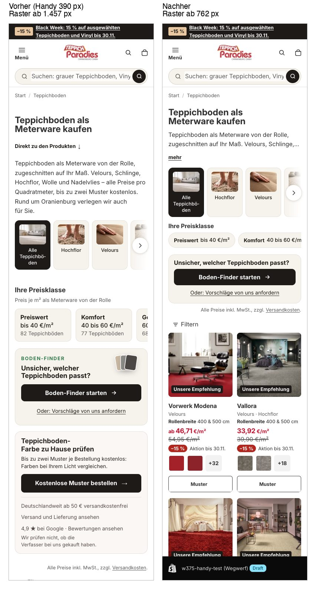
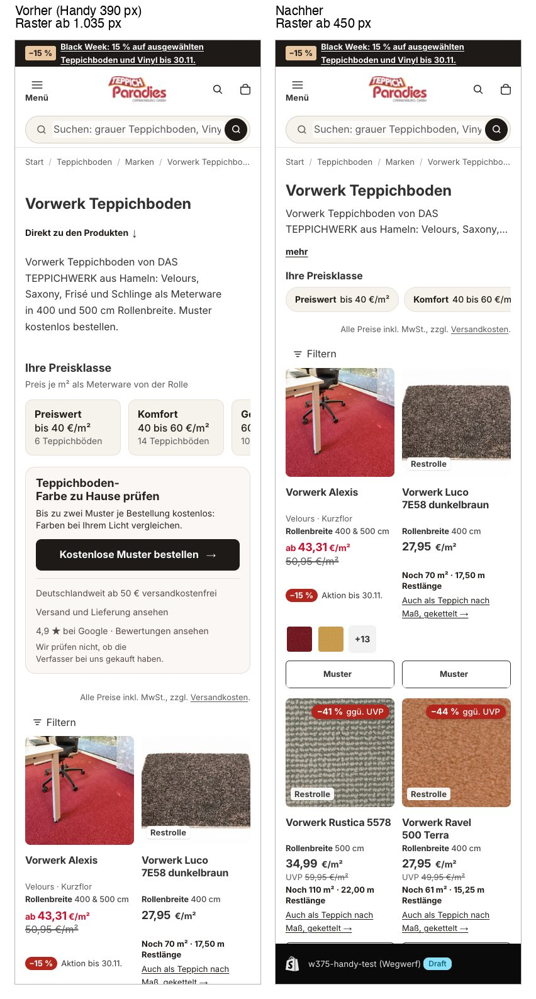
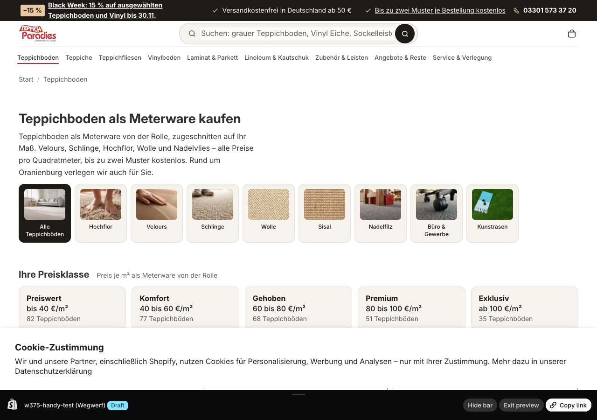

# w-375: Kategorieseiten am Handy – Produkte früher zeigen

Test auf **Teppichboden** (`/collections/teppichboden`) und **Vorwerk Teppichboden**
(`/collections/vorwerk-teppichboden`), freigegeben vom Inhaber am 13.11.2026. Alle anderen
Kategorien, auch JAB in derselben Vorlage wie Vorwerk, bleiben unverändert (Kontrolle).

## Was sich am Handy (bis 749 px) ändert

| Teil | vorher | nachher |
|---|---|---|
| Einleitung | 5–6 Zeilen | 2 Zeilen, „mehr“ klappt auf |
| „Direkt zu den Produkten“ | Link | entfällt (Raster beginnt direkt darunter) |
| Preisklassen | 5 Kacheln mit Titel, Hinweis, Trefferzahl (176 px) | eine Zeile schmaler Chips (94 px); Filterlogik unverändert |
| Boden-Finder (nur Teppichboden) | großer Kasten mit Muster, Schritten (224 px) | Überschrift, Knopf, Link (140 px) |
| Musterkasten | vor dem Raster (358 px) | **im Raster nach Produkt 4** (bei weniger Treffern nach dem letzten) |

Desktop und Tablet ab 750 px: unverändert (Abschnittspositionen bei 1280 px und 768 px Pixel für Pixel gleich).

## Messung (Chrome, 390 px Breite, Beginn des Rasters = Oberkante der Sektion `main`)

| Seite | vorher | nachher | Unterschied |
|---|---|---|---|
| Teppichboden | 1.457 px | 762 px | −695 px (−48 %) |
| Vorwerk | 1.035 px | 450 px | −585 px (−57 %) |
| JAB (Kontrolle) | 984 px | 984 px | 0 |

Erste Produktkarte: Teppichboden 1.528 → 833 px, Vorwerk 1.106 → 521 px (erster Bildschirm = 844 px).
Gemessen mit `getBoundingClientRect().top + scrollY` auf `[id$="__main"]` bzw. `.product-grid__item`.
„Nachher“ zuerst in einem Wegwerf-Theme aus diesem Branch (gleiche Einstellungen wie live), danach im Live-Shop.

Die dunkle Leiste unten im „Nachher“ ist die Vorschauleiste des Wegwerf-Themes.

## Umsetzung

- `snippets/tp-mobil-kompakt.liquid`: die einzige Liste der Test-Kategorien (Handles). Weitere Kategorien: Handle ergänzen.
- `blocks/tp-mobil-kompakt.liquid`: Kopfbereich (Einleitung gekürzt, „mehr“-Knopf, Abstände) – in beiden Vorlagen hinter der Einleitung.
- `sections/tp-preisklassen.liquid`, `sections/tp-boden-finder.liquid`: Kompaktklasse nur bei den Test-Kategorien.
- `snippets/tp-teppichboden-kampagne-kasten.liquid`: Musterkasten, von der Sektion und vom Raster-Einschub genutzt (`sections/main-collection.liquid`).

## Zurück

Handle aus `snippets/tp-mobil-kompakt.liquid` entfernen (Kategorie sieht wieder aus wie vorher) – oder den PR zurücknehmen.

## Bewusst anders als in der Aufgabe

Preisklassen und Boden-Finder stehen als schmale Streifen weiter **vor** dem Raster, nicht darunter: Die Preisklassen
sind ein Filter, der sich beim Klick selbst neu rendert (`assets/tp-preisklassen.js`), und der Boden-Finder ist ein
Dialog mit eigenem Skript. Beide in das Raster zu verschieben hätte sie doppelt oder per Skript umgehängt. Nur der
Musterkasten (reines HTML) wandert ins Raster.
